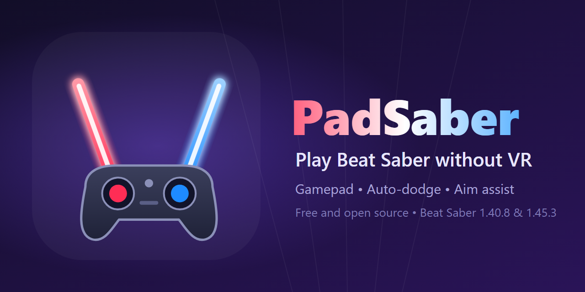

<p align="center"></p>

# PadSaber

Play Beat Saber on a normal PC with an Xbox-style (XInput) gamepad. No headset or OpenXR runtime needed. Includes head look, manual and automatic dodging, aim assist toward the next block, and controller rumble.

*(Under the hood the plugin is still called `NonVRMod`, so you'll see that name in file names, the settings file and logs.)*

**New here? Follow the step-by-step guide: [TUTORIAL.md](TUTORIAL.md).**

You need your own copy of Beat Saber (Steam, Oculus/Meta Store or any other legitimate copy). This repo contains only the mod; no game files. It is an unofficial fan mod and is not affiliated with Beat Games or Meta.

## Supported game versions
Only two versions are supported: **1.40.8** and **1.45.3**. The installer reads your game's version and installs the matching build, or stops with a message if your version is neither. On Steam you can pick a version under Properties > Betas.

If you change game versions after the mod loader (BSIPA) was installed, start the game once and close it before running `Install.bat`: on the first start after a version change BSIPA moves everything in `Plugins` to an `Old <version> Plugins` folder. The installer tells you when this applies.

## Install
1. Install a supported Beat Saber version (Steam, Oculus/Meta Store or any other copy) and close it.
2. Run `Install.bat`. It looks for your game (Steam libraries and Oculus folders) and asks where Beat Saber is:
   - press **Enter** to use the folder it found,
   - **paste** a folder path (quotes and a trailing `\` are fine), or
   - type **B** to pick the folder in a window.
   The folder must contain `Beat Saber.exe`. It then installs the BSIPA mod loader if missing (downloaded from its official release) and copies the mod into `Plugins`. Your choice is remembered for next time.
   To skip the question: `Install.bat "D:\Games\Beat Saber"`.
3. Plug in a controller and start the game with `Launch.bat` (it starts the folder you chose, or Steam if none was saved), or as usual from Steam / your launcher. Do not use the `fpfc` launch option.

## Controls
Each stick sweeps its saber through an arc, so a flick is a swing and both hands move independently. When you let go, the saber returns to center slowly so the rebound does not cut anything.

| Action | Gamepad |
|---|---|
| Left / right saber | Left / right stick |
| Look around (head yaw / pitch) | D-pad |
| Recenter view | Click either stick (L3 / R3) |
| Side-step left / right | LB / RB |
| Duck by hand (auto-dodge also ducks) | Hold B |
| Click / triggers | A or RT / LT |
| Menus: turn the view (the laser stays at screen center) | Right stick |
| Scroll lists | Left stick |
| Sensitivity preset (Soft / Normal / Fast) | Y |
| Toggle auto-dodge | Back (or F8) |
| Toggle aim assist | LT + Y (or F7) |
| Controls panel | X |
| Pause | Start |
| Hide on-screen hints | F9 |

In menus the right stick turns the view and the laser stays at screen center. Sabers stay in place when you look around, as they would in VR. Auto-dodge steps sideways and ducks under low walls by itself, and the sabers move with your body when you dodge. Hold B to duck by hand and LB/RB to side-step by hand; whichever axis you control, the other stays automatic. Rumble follows the game's own haptics (cuts and so on).

## Tuning
Edit `UserData\NonVRMod.json` in the game folder (the game creates it on first run) and restart the game.

| Setting | Meaning |
|---|---|
| `MaxYaw`, `MaxPitch` | How many degrees the saber swings at full stick |
| `FollowSpeed` | How fast the saber follows the stick (higher = snappier) |
| `ReturnSpeed` | How fast it recenters on release (lower = softer) |
| `Preset` | 0 Soft, 1 Normal, 2 Fast (Y cycles it) |
| `SquareStick` | On: a diagonal stick push reaches full range on both axes, so corner blocks are reachable |
| `ResponseCurve`, `StickDeadzone` | Stick feel: higher curve = finer control near center |
| `SwapSticks`, `InvertY` | Left-handed layout, inverted vertical axis |
| `HandHeight`, `HandSpread`, `HandDepth`, `HandShift` | Where the hands rest and how much they drift |
| `RestPitch` | Resting saber tilt |
| `LookSpeed`, `HeadMaxYaw`, `HeadMaxPitch`, `HeadReturnSpeed` | Head look (return speed above 0 recenters on release) |
| `FieldOfView`, `HeadBack`, `Fullscreen` | The view |
| `Rumble`, `RumbleStrength` | Controller vibration |
| `ManualDodge` | LB/RB/B dodging on or off |
| `AutoDuck`, `AutoDuckMinHeight` | Auto-dodge also lowers the view under low walls, down to this height (meters) |
| `AutoDodge`, `LookaheadMeters`, `MaxSideStep`, `DodgeSpeed` | Auto-dodge (offline play only) |
| `MenuLookSpeed`, `MenuMaxYaw`, `MenuMaxPitch`, `MenuCrosshair` | Menu view: turn speed, how far it can turn sideways / up and down (degrees), optional center dot |
| `AimAssistOn`, `AimAssist`, `AimAssistRange` | Pull each saber toward the next block of its color while the stick is pushed that way (0 to 1, meters ahead) |
| `DebugLog` | Log auto-dodge walls and aim-assist targets to `Logs\_latest.log` |

## Build from source
```
Build.bat "C:\Program Files (x86)\Steam\steamapps\common\Beat Saber"
```
Run it once per supported version, with that version installed (BSIPA must already be in the game folder). It reads the game version, stamps it into the mod's manifest, and writes `dist\<version>\NonVRMod.dll`, which `Install.bat` picks by version. The DLL is also copied into that game's `Plugins` folder.

## If it doesn't work
Open `Logs\_latest.log` in the game folder. Lines like `Patch target not found: X.Y` mean the game's class names differ from the version this build was made for; the patches are in `Patches/`. If the on-screen hint says no gamepad was detected, the controller must be XInput-compatible (Xbox layout) and connected before the game starts.

## Support
The mod is free and always will be. If you like it and want to say thanks, donations are welcome but never expected.

| Coin | Network | Address |
|---|---|---|
| ETH | Ethereum (mainnet) | `0xFaEB18c7E0cb581dF7A0E1069c9c9Bec48c2B28D` |

Send only ETH (or ERC-20 tokens such as USDT/USDC) on the Ethereum network to this address. Do not send Bitcoin or coins from other networks, because they will be lost. Check the address in this README on the official repository before sending.

## License
MIT, see `LICENSE`. The mod loader (BSIPA) is downloaded by the installer from its official release and is not part of this repository.
